# Outshine

Outshine is a data-driven open-world sandbox.

**Wien**

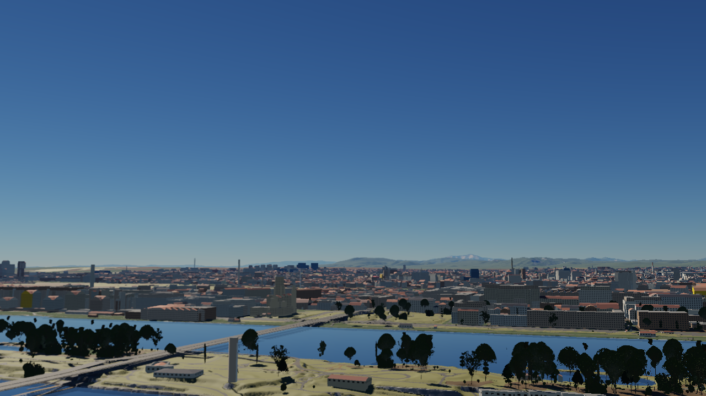

**Flensburg**

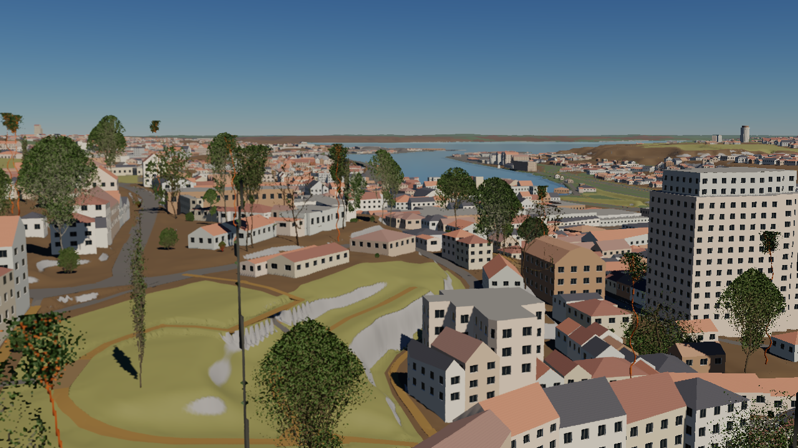

**Rosenheim**

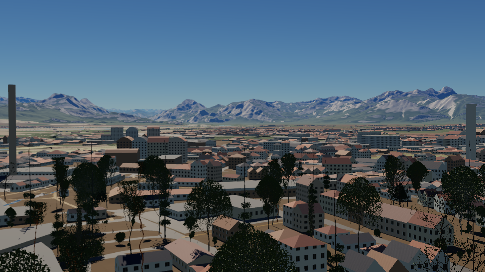

**Darmstadt West**

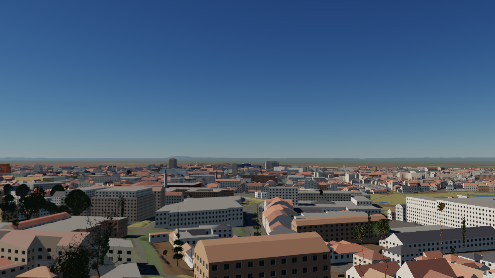

**Husum**

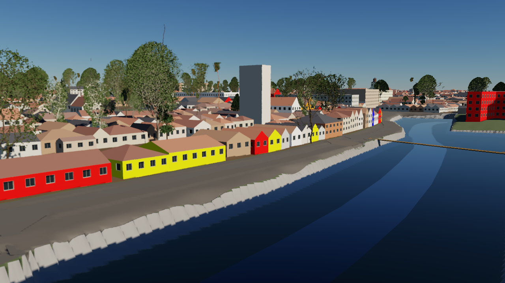

**Körbersee**

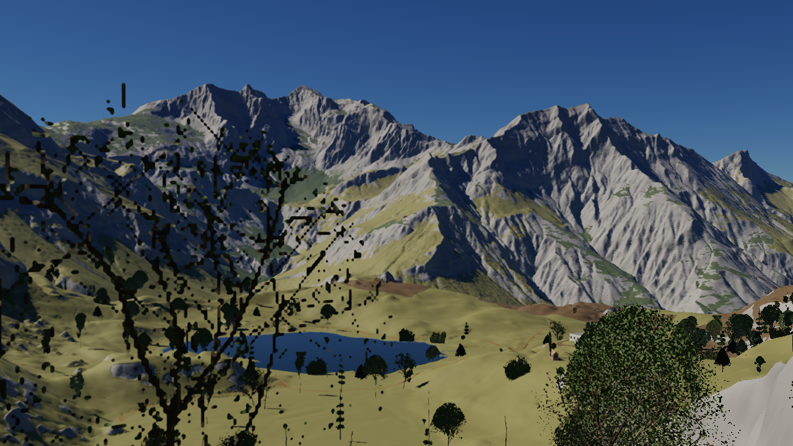

**Feldkirch**

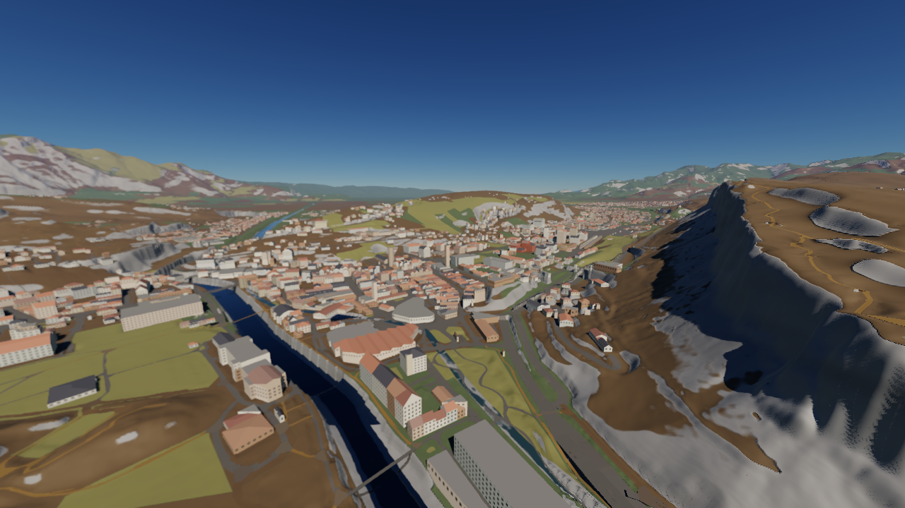

**Malcesine**

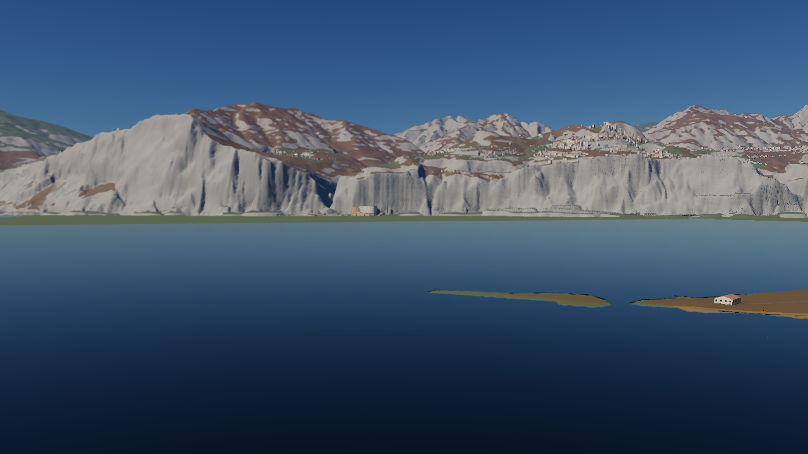

**Basel Badischer Bahnhof**

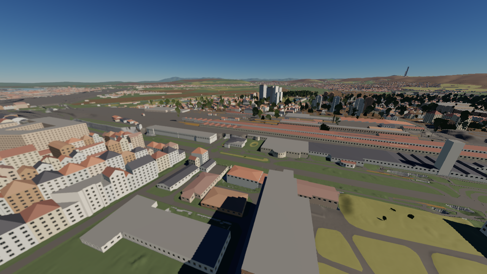

**Zürich Hauptbahnhof**

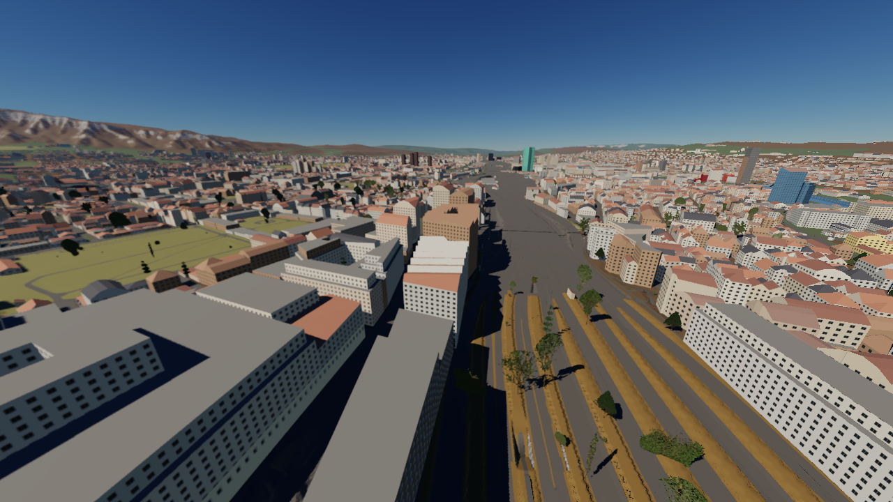

**Tokyo**

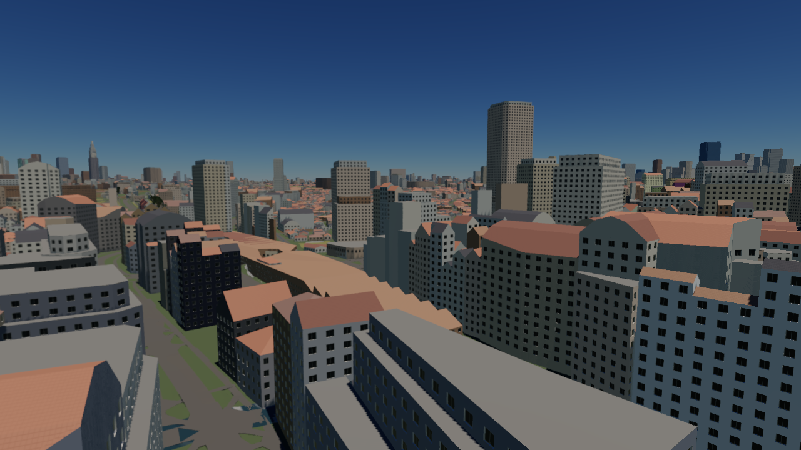

**Central Park, New York**

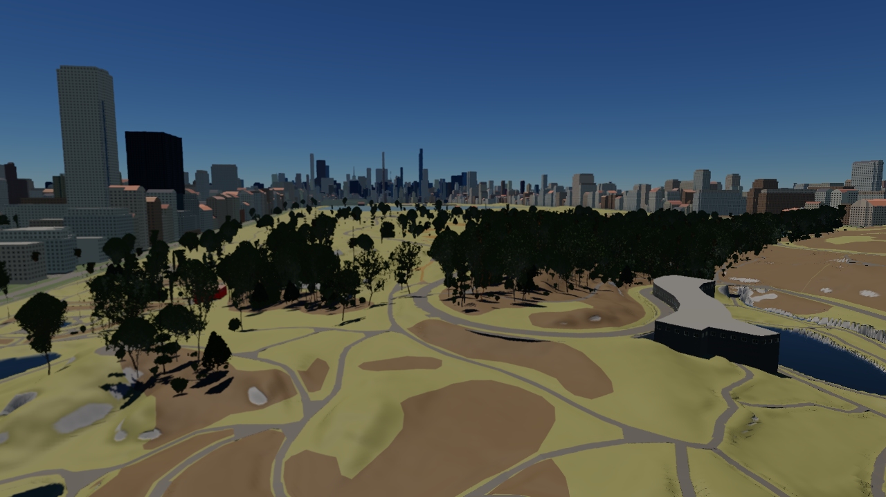
