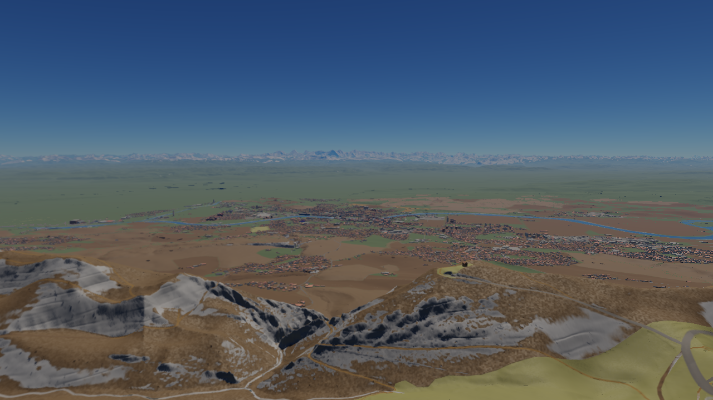

# Outshine

Outshine is a worldwide, data-driven open-world sandbox. It builds a plausible
Earth from elevation, OpenStreetMap and weather data, with original procedural
recipes filling in local detail. Visual quality is judged against real scenes
and by what physically based rendering can deliver on an A18 Pro with 8 GB
of shared memory.

Phase 1 develops the image in Blender using the Python generators, with
plausible OSM infrastructure and varied vegetation as the main work. The
[roadmap](https://github.com/Weichwolf/outshine/issues/1972) tracks observable
results. The [Python generator references](lib/) preserve the research and
recipes. [Literature](doc/references/) and [concept examples](doc/images/concept/)
inform implementation choices.

