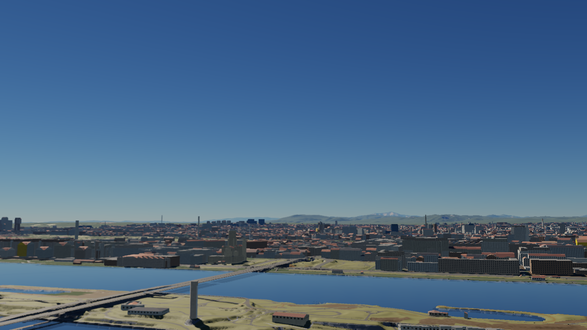
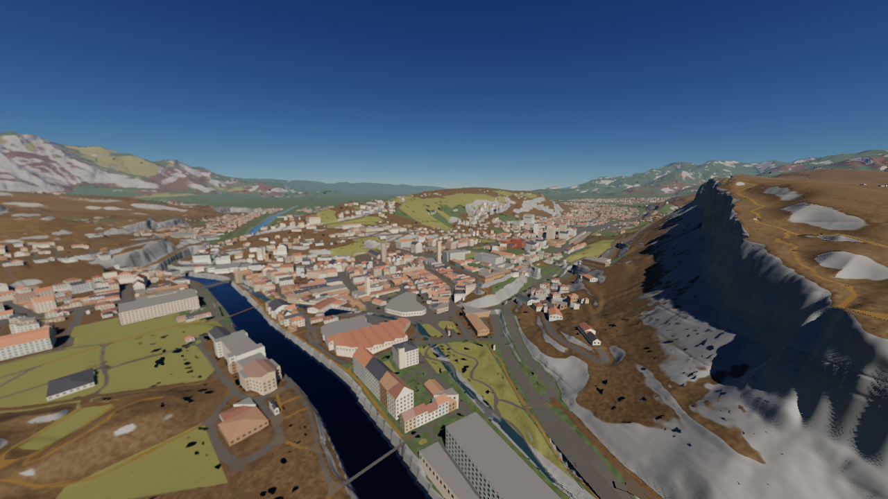

# Outshine

Outshine is a worldwide, data-driven open-world sandbox. It builds a plausible
Earth from map, elevation and weather data with procedural recipes.

The next engineering milestone is a new native distance and residency path
alongside the working application. The first comparison is a depth-aware far
cubemap, followed by grouped impostors and detailed near geometry. The
[roadmap](https://github.com/Weichwolf/outshine/issues/1972) defines the rollout
and acceptance. [Python references](lib/), [literature](doc/references/) and
[concept examples](doc/images/concept/) support the work. The
[comparison commit](https://github.com/Weichwolf/outshine/tree/0932b78323ebf23016f723fdfb3fa31da2e28337)
preserves the previous comparison build's source.

