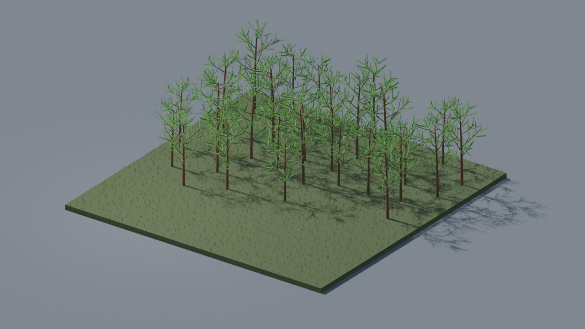
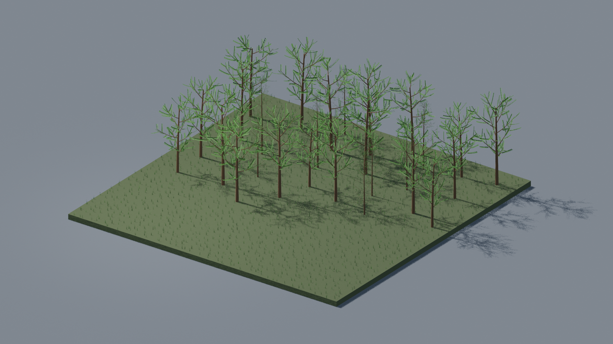
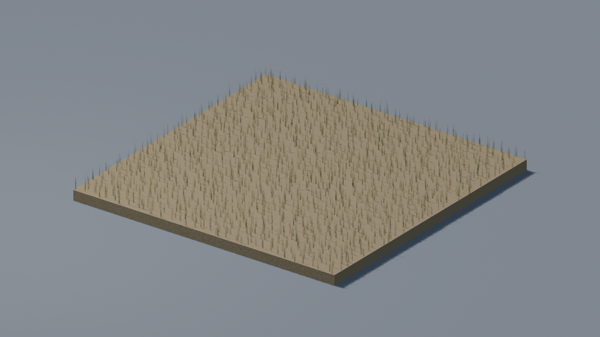
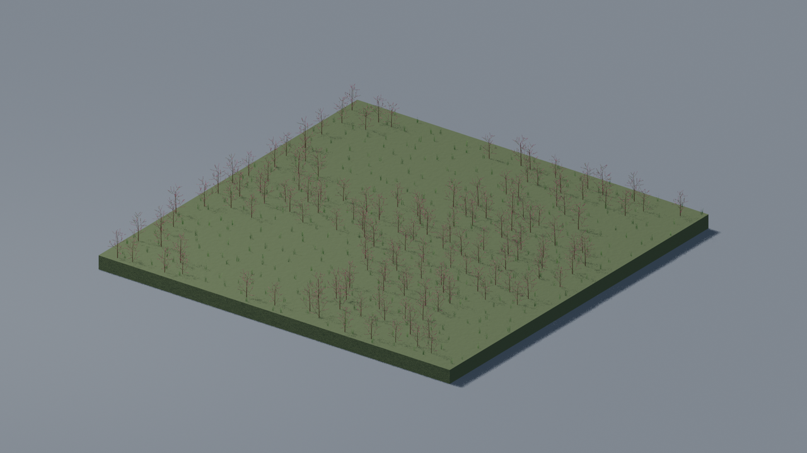

# Vegetation

Aktueller Python-Forschungsstand auf flachen Kacheln, jeweils1280×720.
Kronendeckung, Wiesen und Heideformen sind noch unvollständig.
[Verfahren und Grenzen](../../../test/experiments/vegetation/biome_tiles.md).

Laubwald

Mischwald

Steppe

Heide
