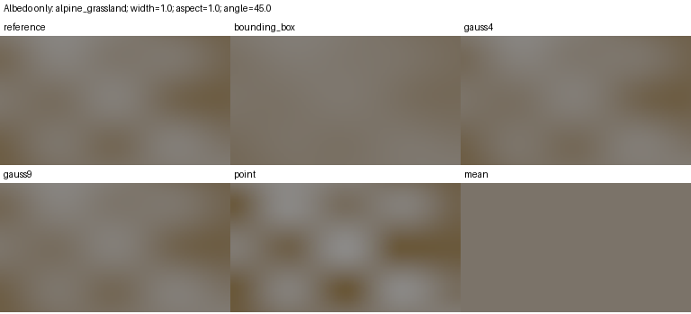
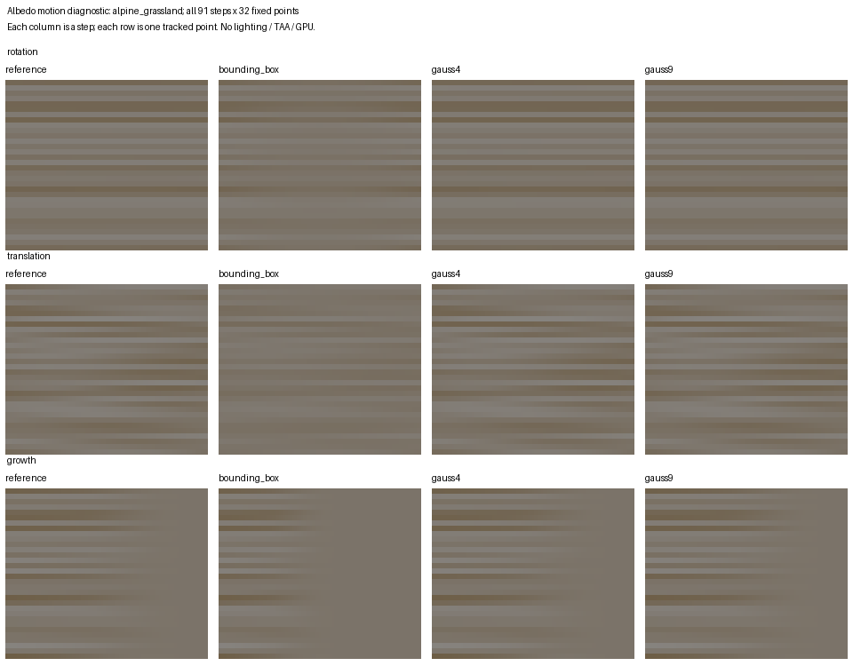
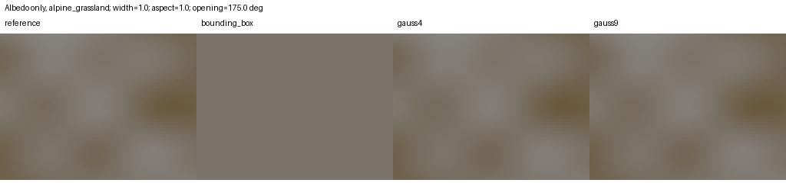
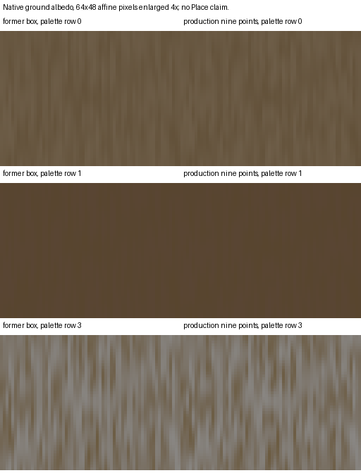

# Ground litter over the actual pixel footprint

These experiments belong to [#196](https://github.com/Weichwolf/outshine/issues/196).
They evaluate the existing cubic value-noise mask and shipped material recipes.
They do not render lit Places, simulate a camera, evaluate TAA or measure GPU time.

The former production filter integrated the axis-aligned bounding rectangle of the two
XZ screen derivatives. A rotated pixel has a different area and different fade:
the bounding rectangle can reach the two-cell mean cutoff before the actual
derivative length does. Parameter blending and the palette layout are independent
of this choice of mask filter.

`ground_litter_footprint.py` compares that rectangle with a midpoint integral over
the actual parallelogram, point sampling, four or nine tensor Gauss samples, and
the constant mean. Both reference and oriented candidates retain the existing
smooth one-to-two-cell fade, using the maximum derivative length. This is a
bounded approximation, not a claim of exact band limiting or BRDF integration.
The current input set rotates orthogonal derivatives and varies their aspect;
it does not cover every sheared Jacobian.

On 126 footprints, 128 fixed points and three shipped recipes, the largest RGB
errors were 0.04021 for the rectangle, 0.007152 for four samples and 0.0008882 for
nine samples. The independent 32/64 midpoint refinement differed by at most
0.0001016 in the scalar field. The existing square-footprint wrapper remains
unchanged; rectangular integration is the same separable procedure.



`ground_litter_motion.py` follows 32 deterministic world points through 91 steps
of square-footprint rotation, translation and growth across the mean cutoff.
The reference uses 128 by 128 midpoint samples and is checked against 64 by 64.
It measures both absolute colour error and the difference between candidate and
reference changes from one step to the next. A constant result can have low
temporal variation while losing the correct spatial signal; both errors matter.

Alpine grassland results, linear RGB RMS:

| Track | Box colour error | Four samples | Nine samples | Box step error | Four samples | Nine samples |
|---|---:|---:|---:|---:|---:|---:|
| Rotation | 0.0096684 | 0.00080142 | 0.00010342 | 0.00034792 | 0.000021732 | 0.0000064672 |
| Translation | 0.013550 | 0.00086035 | 0.000075018 | 0.00045336 | 0.000064458 | 0.000017380 |
| Growth | 0.0090981 | 0.00092853 | 0.000099753 | 0.00054851 | 0.000053356 | 0.0000080502 |

The reference refinement's step RGB RMS is respectively 4.36e-9, 5.67e-8 and
3.95e-8. All candidates remain finite and bounded, return the exact mean after
the two-cell cutoff and reproduce the quarter-turn square identity. These are
measured cases, not global bounds or a temporal reconstruction guarantee.



`ground_litter_shear.py` extends the area comparison to 120 Jacobians, including
both handednesses, opening angles of 5/175 degrees and rank-one limits. It uses
32 fixed points and the same three recipes, a 128x128 midpoint reference and
64x64 refinement. The maximum field refinement delta is 0.00002540. Reversing
one derivative and exchanging both derivatives preserve each candidate to
1e-12; no division by a nearly zero determinant is required.

Across this additional set, maximum linear RGB errors are 0.07364 (box),
0.007151 (four samples) and 0.0006455 (nine samples). These maxima occur in
different cases; they are finite-set results, not global bounds. The largest
box error occurs for alpine grassland, width 1, aspect 1, angle 0 and opening
175 degrees. The box fade is almost zero, while the derivative-length fade is
one. The nine-sample RGB error in that same case is 0.0002365.



The diagnostic samples a fixed world patch; probe spacing is independent of the
footprint and its 64x48 samples are enlarged for inspection. It is albedo only,
without geometry, lighting, native execution or a Place-image claim. Rank-one
results use the limiting integral of the parameter square, not a uniform line
average. This closes the declared shear test gap for these examples, not an
arbitrary-Jacobian accuracy guarantee.

Four and nine samples require at most 16 and 36 corner hashes without sharing;
the rectangle uses at most 16. Arithmetic, register pressure, actual branches
and backend execution can outweigh these counts. Nine samples are now the production default after the finite-set quality and
native component-cost comparisons in #196/#268. Master retains the subsequent
identical lit Place, Metal/A18 and integrated frame/memory counterchecks. No new buffer, texture, sampler, attachment or
pass is required by either oriented candidate.

Run with Python, NumPy and Pillow from the repository root:

```sh
python3 test/experiments/render/ground_litter_footprint.py --output /tmp/outshine-material-footprint
python3 test/experiments/render/ground_litter_motion.py --output /tmp/outshine-material-motion
python3 test/experiments/render/ground_litter_shear.py --output /tmp/outshine-material-shear
```

Outputs are private system-temp artifacts: numerical records with source/input
hashes and diagnostic PNGs. No reference pins or product assets are rewritten.
The orientation motivation is SIGGRAPH 2009, *Sparse Gabor Noise*, section 5.2
and figure 6 (PDF page 6), previously inspected as a rendered page. This uses
the existing value noise, not Gabor noise. Technique decisions remain in #196.

The native choice chart is reproducible with the shared linked consumer and the
artifacts from `ground_litter_shaders.py`:

```sh
python3 test/experiments/render/ground_litter_choice_image.py --binary /path/to/native_material --shaders /tmp/outshine-material-oriented --output /tmp/outshine-material-ground-choice
```

It captures9216 actual full-surface albedo values from three pinned palette rows
on oblique affine pixels, before/after. The64×48 images are enlarged4×; pixel
spacing matches the declared derivative pair. This remains a component image,
without lighting or a Place claim. NumPy and Pillow are required.


